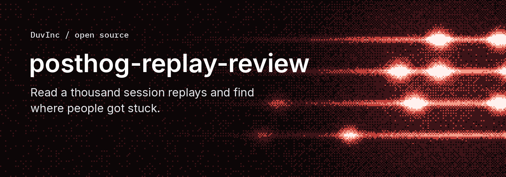

# posthog-replay-review



**You have a thousand session replays and no time to watch them. This reads them for you, and tells you where people got stuck, with the exact moments to check.**

```bash
node bin/replays.mjs candidates --days 14   # free: which sessions are worth reading
node bin/replays.mjs timelines --top 40     # free: each replay as numbered text
node bin/replays.mjs analyze --dry-run      # free: prints the calls and the cost
node bin/replays.mjs analyze --max-usd 0.02 # paid: replays-out/report.md
```

```text
## 0192f3a1-demo (left_at_paywall)

They tried to create a workspace on mobile, then hit a 6,950-credit paywall with
an empty balance and left.

- **high · ux**: "Create workspace" did nothing visible with an empty name.
  - Fix: Show the error under the field instead of relying on the browser bubble.
  - `3 00:04 click tap button "Create workspace"`
  - `4 00:06 screen no visible change after the click`
```

**Measured on a real product: 975 recordings over 14 days, 136 sessions worth
reading, all of them reviewed for $0.04.** The review found a dead button in the
mobile onboarding, a post-payment dialog that only closed itself, a free sample
announced as "the first 5 segments" when it covered 86% of the file, and English
thousands separators in four languages. Three fixes shipped the same day.

## How it works

```text
recordings ──▶ hard filters ──▶ rrweb digest ──▶ numbered timeline ──▶ triage ──▶ analysis ──▶ report
  PostHog     your events,     DOM rebuilt in   redacted, one       decision     cheap model   quotes pulled
              weights, URL     code, no browser line per moment     model (opt.) (flex tier)   back by number
```

A session replay is not a video. It is a DOM snapshot followed by a stream of
mutations, clicks and inputs, recorded with [rrweb](https://github.com/rrweb-io/rrweb).
The obvious way to review it with AI is to play it, take screenshots and send
them to a vision model. That is slow, it costs a lot per session, and it loses
the one thing you want most: the exact text the person was looking at when
they gave up.

So this does the opposite. `lib/rrweb.mjs` rebuilds the DOM as a plain tree,
applies every mutation, and writes down what happened in words:

```text
session 0192f3a1-demo
duration 00:57, viewport 360px wide
signals: upgrade_prompt_viewedx1 console_errorsx1; goals reached: none

  1 00:00 nav     page https://app.example.com/onboarding (360x640)
  2 00:02 screen  new on screen: Signed in as <email> · Create workspace
  3 00:04 click   tap button "Create workspace"
  4 00:06 screen  no visible change after the click
  5 00:07 type    typed in input "Workspace name" (7 chars, masked)
  6 00:10 click   click button "Create workspace"
  7 00:11 event   upgrade_prompt_viewed (credits_needed=6950 credits_balance=0)
  8 00:12 screen  dialog: Your file is ready. This translation uses 6,950 credits.
  9 00:14 click   click input "Choose a file"
 10 00:16 type    chose a file in input "Choose a file"
 11 00:16 idle    no activity for 41s
 12 00:17 console error: "TypeError: Failed to fetch"
```

That text is what a model reads. A nine-minute session is about 130 lines and
3,000 tokens. The models never see a raw recording, never see what was typed
(the field and the length only), and never write a quote: they answer with line
numbers, and the report pulls those lines back from the timeline. A cited line
that does not exist is flagged instead of trusted.

The design decision that matters most is that **code produces every fact and the
model only judges**. A model asked to summarise a session writes a fluent story;
a model asked to cite line numbers can be checked, line by line, by code.

## Who reads the timelines: your agent, or models you outsource to

The two free steps already give you something to act on: numbered, redacted
timelines in `replays-out/timelines/`. What reads them is your choice.

**Your coding agent, no API key.** Claude Code, Cursor or Codex can read a
timeline as well as a small model can, and
[`skills/posthog-replay-review/SKILL.md`](skills/posthog-replay-review/SKILL.md)
tells it how. That is the right setup for ten or twenty sessions, or to check
what the models said. It does not scale: a hundred timelines is about 300,000
tokens of reading in your agent's context, at your agent's price.

**Outsourced to small models, to be efficient and to scale.** The two paid
steps send each timeline to a model through an API, in parallel, with a
schema, so the answer is structured and checkable. 136 sessions cost $0.04.
Your agent then reads the report, not
the 136 timelines. To set it up with [OpenRouter](https://openrouter.ai), which
gives one key for every model below:

1. Create a key at https://openrouter.ai/settings/keys. Give it a credit limit
   (a dollar is plenty to start): the key cannot spend past it whatever runs.
2. Add a few dollars of credit at https://openrouter.ai/settings/credits.
3. Put it in `.env` as `OPENROUTER_API_KEY`. The key is read at call time by
   `lib/llm.mjs` and `lib/decide.mjs` only.
4. Run every paid step with `--dry-run` first, then with `--max-usd`.

Any other OpenAI-compatible gateway works too (`LLM_BASE_URL`, `LLM_API_KEY`),
as long as its models accept a JSON schema in `response_format`.

### Pick the models

Set them in `replays.config.json` (`triageModel`, `analysisModel`) or with
`--triage-model`.

| Step | Default | What it is | Alternatives |
| :--- | :--- | :--- | :--- |
| Triage: is this session worth a look? | `typesafe/jev-1.13` | a decision model: typed yes/no questions, a probability back, one call per session | another decision model such as `inception/mercury-decide`, or a chat model with a JSON schema |
| Analysis: what happened, what to fix | `openai/gpt-6-luna` on the flex tier | a cheap chat model, half price on flex | any chat model that takes a JSON schema |

**Triage is a decision, so a decision model does it.** A decision model answers
typed yes/no questions with a probability read from the model, instead of a
yes/no a chat model wrote. `lib/decide.mjs` sends each timeline as the state, on
OpenRouter's decisions endpoint, and asks six questions: worth a closer look,
and one per category (blocked by price, UX friction, bug, confusion, unexpected
use). A session is kept above 0.5, and you get a number to sort by.

The default is TypeSafe's jev. **Any other decision model on the same endpoint
works by changing one value**, for example Inception's Mercury Decide, which
also has a free, rate-limited variant for pilots:

```json
{ "triageModel": "inception/mercury-decide" }
```

A chat model with a strict JSON schema (`inception/mercury-2.5`, through
`lib/llm.mjs`) works too, and is the only kind that also names the key lines of
each session.

Measured on the same 10 sessions (2026-10-20):

| | jev 1.13 (default) | Mercury Decide | Mercury 2.5 (chat) |
| :--- | :--- | :--- | :--- |
| Cost for 10 sessions | $0.0009 | free variant used; ~$0.0003 at the listed $0.02 per 1M input | ~$0.0010, at an 80% promotional discount |
| Time for 10, five at a time | 1.5 s | 1.6 s | |
| The 6 sessions with clear frictions | kept (0.63 to 0.93) | kept (0.85 to 1.00) | kept |
| A real i18n friction (English in a German interface) | kept (0.72) | kept (0.73) | dropped |
| A likely false positive (the person's own instruction in another language) | kept (0.65) | dropped (0.08) | dropped |
| 2 sessions with too little activity | dropped | dropped | dropped |

On this sample Mercury Decide sorted best and costs least; jev, the default,
keeps a little more. Ten sessions is a pilot, not a benchmark: run
`triage --dry-run` and a pilot of ten on your own sessions before choosing.

**One threshold per model.** Decision models do not share a probability scale,
so 0.5 on jev and 0.5 on Mercury Decide are not the same cut. A session is kept
at 0.5 by default; if you switch models, look at the probabilities of a pilot
and set `"triageThreshold"` in the config to the value that keeps the sessions
you would have wanted to read.

## Try it locally

```bash
git clone https://github.com/DuvInc/posthog-replay-review.git
cd posthog-replay-review
npm install                                   # installs nothing
npm test                                      # no network, no key
cp .env.example .env                          # PostHog read key, OpenRouter key
cp examples/replays.config.example.json replays.config.json
```

Edit `replays.config.json`: one or two sentences on what your product does and
how it charges (the models read it), your app's URL pattern, and the product
events that mark a decision, with weights. Then run the commands at the top.

Without an OpenRouter key, everything up to the timelines works, and the paid
steps run with `--dry-run` to show what they would cost.

To look at one session where the text is not enough:

```bash
node bin/replays.mjs player 0192f3a1-...
python3 -m http.server --directory replays-out/player 8799
```

## Putting it in your product

Use the library and keep the CLI as a reference. In order of importance:

1. **Your decision events.** The hard filters are only as good as the events
   you name. With only `$rageclick` and `$exception`, most sessions score zero.
   Name the moments that matter: a paywall shown, a checkout started, an account
   deleted, a first file processed.
2. **The product sentence.** The models judge friction against what the product
   is supposed to do. One accurate sentence about how it charges changes what
   they call a pricing problem.
3. **Your own transports.** Both outside calls are injected:

```js
import { createPostHogClient, decodeSnapshots, buildTimeline, analyze, renderReport } from "posthog-replay-review";

const posthog = createPostHogClient({ host, projectId, apiKey });          // or { fetch: yourProxy }
const events = decodeSnapshots(await posthog.downloadSnapshots(recordingId));
const timeline = buildTimeline({ id: recordingId, events, productEvents });

const { results, spent } = await analyze([timeline], {
  product: "One sentence on what the product does and how it charges.",
  complete: async ({ model, system, user, schema, maxTokens, flex, strict, reasoning }) =>
    ({ value: /* parsed JSON */ {}, cost: 0, tier: "default" }),         // any model you trust
  maxUsd: 0.05,
});
const markdown = renderReport(results, [timeline]);
```

`createCompleter()` in `lib/llm.mjs` is the OpenRouter-compatible default.

## What it costs, measured

| Run (2026-10-19, before jev was the default) | Sessions | Triage (`inception/mercury-2.5`) | Analysis (`openai/gpt-6-luna`, flex) |
| :--- | ---: | ---: | ---: |
| First pilot | 4 | $0.0008 | $0.0013 |
| Highest-scored first | 27 | $0.0024 | $0.0072 |
| The remaining sessions | 109 | $0.0105 | $0.0187 |

About $0.0003 per session for both steps, on a file-translation SaaS. Prices
read from OpenRouter on 2026-10-19. The time goes to downloading snapshots from PostHog, not to models:
blobs are fetched 20 per request, the most the endpoint takes, and PostHog's
1,200-requests-an-hour cap on a personal key is honoured when it is hit. The 109
sessions took about twenty minutes to download.

Behind good hard filters, the triage step added little: it kept 25 of 25 in one
run. It earns its cost on an unfiltered set; skip it with `analyze --all`.

## What this is not

- **Not a funnel or a dashboard.** It tells you what happened in specific
  sessions, with line numbers. Counting is PostHog's job.
- **Not proof.** Two sessions showing the same friction is a signal. The report
  says how many sessions each finding rests on; check the code before you fix.
- **Not anonymous.** Inputs arrive masked and emails, long numbers and URL
  tokens are stripped, but names and free text on screen pass. Timelines are
  personal data, and sending them to a model makes its provider a sub-processor.
  See [SECURITY.md](./SECURITY.md).
- **Not a video reviewer.** Canvas, video and anything drawn without DOM text
  are invisible to the digest. The player is there for those moments.
- **Not PostHog-only underneath.** `lib/rrweb.mjs` reads any rrweb recording;
  only `lib/posthog.mjs` knows PostHog.

## Credits

Built on [PostHog](https://posthog.com) session replays and the
[rrweb](https://github.com/rrweb-io/rrweb) format, with models through
[OpenRouter](https://openrouter.ai). MIT licence. See
[CONTRIBUTING.md](./CONTRIBUTING.md) to send a change and [AGENTS.md](./AGENTS.md)
for how the code is organised.
